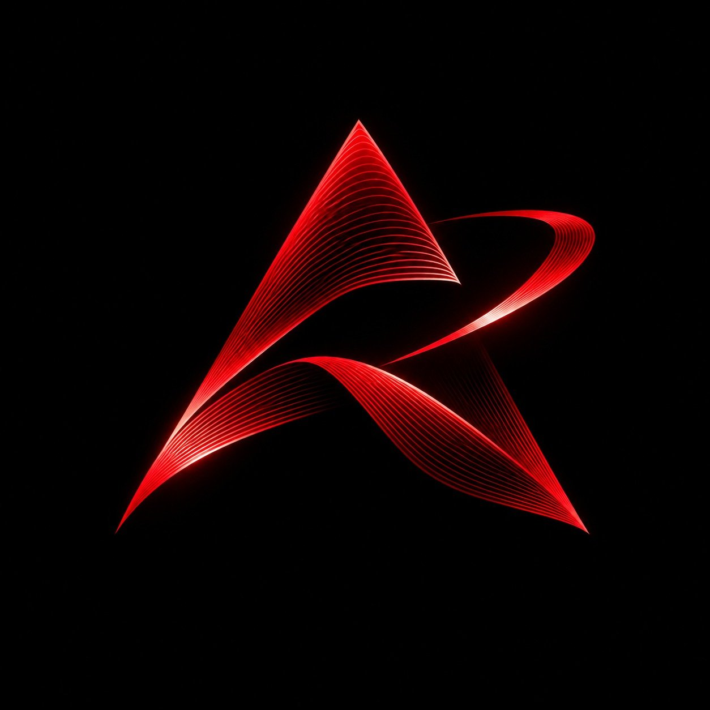

# Adentra MCP

**Adentra MCP server (preview) — the onchain token verifier for AI agents.**

Give your agent a second opinion before every buy. Adentra scores any EVM token
0–100 from real onchain data, lists new pools, checks deployers, and asks the
Guard policy engine before a trade.

- Web: https://adentra.xyz
- X: https://x.com/adentra_xyz

> Preview: this repository contains the Adentra MCP system — the MCP server and
> the agent skill file. The full Adentra web app is separate.

## Tools

| Tool | What it does |
| --- | --- |
| `adentra_check_token` | Score an ERC-20 token (0–100) with findings: honeypot, taxes, owner powers, upgradeability, liquidity, holders. |
| `adentra_list_radar` | List recently detected liquidity pools with quick red flags. |
| `adentra_check_deployer` | Check a deployer wallet's launch history and reputation. |
| `adentra_guard_check` | Ask the Guard policy engine whether an agent trade is allowed (caps, routers, recipients, pause). Returns `ALLOW` or `DENY` with the reason. |

Chains: Base (8453, default), Ethereum (1), Arbitrum (42161), Robinhood Chain (4663).

## Use the hosted server

No setup. Point your MCP client at the hosted endpoint:

```json
{
  "mcpServers": {
    "adentra": {
      "type": "http",
      "url": "https://adentra.xyz/api/mcp"
    }
  }
}
```

## Agent skill

[`skill.md`](skill.md) is the one-page skill for your agent: call Adentra's check
before every buy, skip the token when `safeToBuy` is false (score below 55), and
never buy a token that cannot be sold.

## Scoring

Every token starts at 100; each risk removes points. Selling blocked −100,
buying blocked −40, tax above 10% −30, owner can mint −25, blacklist −20,
no pool −20, upgradeable / owner can change tax / owner can pause trading /
very low liquidity / owner holds over 20% −15 each, tax 2–10% −10, has owner /
low liquidity / owner holds 5–20% / owner can set wallet limits −5 each.
No sell test caps the score at 70. A token posing as an official Robinhood
stock token caps at 40.

Verdicts: 80–100 "Looks safe", 55–79 "Be careful", 25–54 "High risk",
0–24 "Do not buy". `safeToBuy` is true at 55 and above.

## Deploy your own

This is a Vercel serverless function (`api/mcp.ts`). Deploy it with the
Vercel CLI or connect the repo in the Vercel dashboard.

```bash
npm install
npx vercel --prod
```

Environment variables (copy `.env.example` to `.env` for local runs):

- `SUPABASE_URL` and `SUPABASE_SERVICE_ROLE_KEY` — optional. Without them,
  radar and deployer reads return empty, and Guard decisions are not logged.
  The token check works without Supabase.
- `RPC_URL_BASE`, `RPC_URL_MAINNET`, `RPC_URL_ARBITRUM`, `RPC_URL_ROBINHOOD` —
  optional overrides for the public RPC endpoints in `api/_lib/rpc.ts`.

## How it works

- `api/mcp.ts` — JSON-RPC MCP handler (`initialize`, `tools/list`, `tools/call`).
- `api/_lib/scanner.ts` — the scorer: real bytecode scan (EIP-1967 proxy slots,
  keccak function selectors, PUSH4 scan), onchain owner and owner balance,
  plus GoPlus honeypot/tax data and the deepest liquidity pair.
- `api/_lib/guard.ts` — Guard policy engine: daily UTC cap, per-trade cap,
  approved routers/recipients, pause state, decision log.
- `api/_lib/rpc.ts` — public RPC clients for Base, Ethereum, Arbitrum and
  Robinhood Chain.
- `api/_lib/goplus.ts`, `api/_lib/dexscreener.ts` — security feed and
  liquidity data.

## License

MIT — see [LICENSE](LICENSE).
